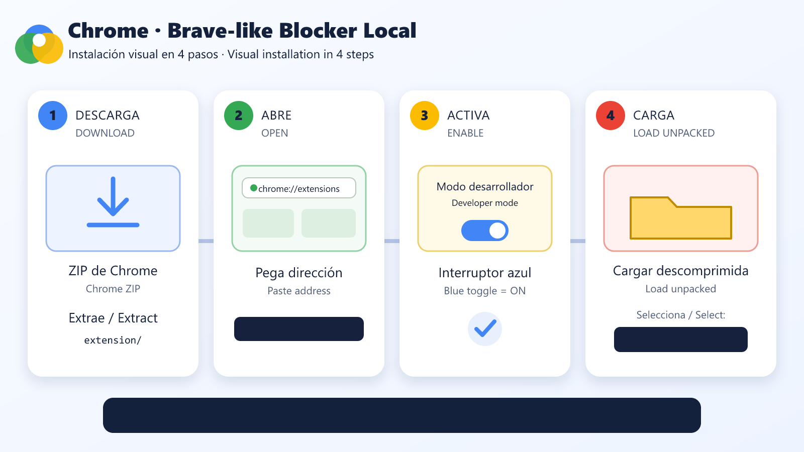
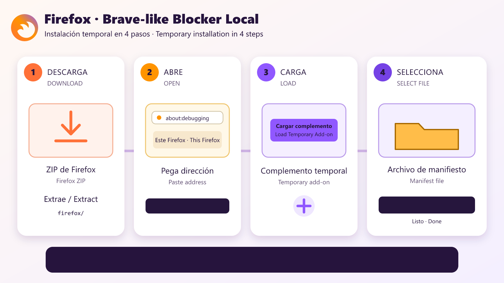

# Brave-like Blocker Local — Chrome + Firefox

[Español](#español) · [English](#english) · [Brave upstream study](docs/BRAVE_UPSTREAM_NOTES.md) · [Releases](https://github.com/eygelias/chrome-brave-blocker-local/releases)

> **Unofficial / No oficial.** Independent WebExtension inspired by Brave Shields. Not affiliated with or endorsed by Brave Software, Google, or Mozilla.

> **Versión v3.1.0:** Sincronización completa con Brave upstream (octubre 2026), suite completa de YouTube Shields de Brave (navegación, modo cine, velocidad y reproducción en segundo plano), eliminación nativa de parámetros de rastreo (Brave Query Filter & Clean URLs), bloqueo de anuncios en vídeo de Twitch (VAFT), CNAME uncloaking y más de 147.000 reglas DNR.

---

# Español

## Qué es

Bloqueador local y silencioso para **Chrome/Chromium Manifest V3** y **Firefox Manifest V3**. Empaqueta reglas DNR y scriptlets oficiales generados desde las listas actuales usadas por Brave Shields, EasyList, EasyPrivacy, uBlock Origin y AdGuard. No tiene cuenta, anuncios propios, telemetría ni descarga código remoto mientras navegas.

Traslada la habilidad y protecciones avanzadas de Brave directamente a Chrome y Firefox mediante WebExtensions seguras.

## Novedades de v3.1.0

- **Sincronización con Brave upstream (octubre 2026)**:
  - Catálogo y fuentes alineados con las versiones actuales de Brave (`brave/adblock-resources` y `brave/adblock-lists`).
  - Incorporación de `brave-firstparty-cname.txt` (desenmascaramiento de CNAMEs y rastreadores de primer nivel).
  - Listas de anuncios en Twitch (`brave-twitch.txt`).
  - Total de reglas DNR en Chrome aumentado a **147.906 reglas** (frente a 129.147 anteriores).
- **Protección de rastreo en URL (Brave Query Filter & Clean URLs)**:
  - Reglas DNR de redirección con `removeParams` que eliminan automáticamente parámetros de rastreo sin retrasos de red ni rotura de navegación.
  - Elimina más de 60 rastreadores universales: `fbclid`, `gclid`, `wbraid`, `srsltid`, `twclid`, `ttclid`, `mc_eid`, `msclkid`, `_gl`, `__hsfp`, etc.
  - Elimina rastreadores específicos de plataforma: Instagram (`igsh`, `igshid`, `stkn`), YouTube (`si`), Twitter/X (`ref_src`, `ref_url`), Amazon (`ref`, `tag`, `ascsubtag`), y Facebook (`__tn__`, `fbclid`).
- **Suite completa de YouTube Shields de Brave**:
  - `brave-yt-sabr-fix.js`: elimina el retraso de 4-16 segundos (spinner SABR) en YouTube móvil (`m.youtube.com`).
  - `brave-youtube-navigation-fix.js`: corrige cuelgues de navegación y de la arquitectura Polymer en YouTube garantizando marcas de tiempo monótonas en `performance.now`.
  - `brave-youtube-theater-fix.js`: preserva la cookie del modo cine (`wide`) ante reinicios de estado del reproductor.
  - `brave-youtube-playback-speed-fix.js`: memoriza la velocidad de reproducción personalizada en `sessionStorage` al pulsar botones en la interfaz de YouTube.
  - `brave-video-bg-play-update.js`: permite reproducción continua en segundo plano en pestañas inactivas y previene interrupciones tipo "¿Sigues ahí?".
  - `yt-main.js`: interceptación y poda quirúrgica de respuestas JSON en player, Shorts, `fetch`, XHR, `Response.json`, `JSON.parse` y respuestas iniciales.
- **Bloqueo de anuncios en vídeo de Twitch (VAFT)**:
  - Scriptlet oficial de Brave `vaft-ublock-origin.js` ejecutado en el contexto de Twitch para eludir anuncios sin buffering ni cortes en el stream.
- **Optimización estricta para Firefox**:
  - Límite exacto de **30.000 reglas** respetando [`ExtensionDNRLimits.sys.mjs`](https://github.com/mozilla-firefox/firefox/blob/main/toolkit/components/extensions/ExtensionDNRLimits.sys.mjs) con retención prioritaria al 100 % de reglas esenciales y muestreo uniforme.

Detalles técnicos y evidencia: [`docs/BRAVE_UPSTREAM_NOTES.md`](docs/BRAVE_UPSTREAM_NOTES.md).

## Funciones

| Función | Chrome | Firefox |
|---|:---:|:---:|
| Bloqueo nativo de red con DNR (hasta 147.906 reglas) | ✅ | ✅ (30.000 máx) |
| EasyList / EasyPrivacy / uBO / AdGuard | ✅ | ✅ |
| Listas Brave First-Party y CNAME Uncloaking | ✅ | ✅ |
| Filtros español y portugués | ✅ | ✅ |
| Ocultación cosmética genérica endurecida | ✅ | ✅ |
| Limpieza de parámetros de rastreo en URL (Clean URLs) | ✅ | ✅ |
| Suite YouTube Shields (SABR, navegación, modo cine, velocidad) | ✅ | ✅ |
| Reproducción de vídeo en segundo plano sin pausa | ✅ | ✅ |
| Bloqueo de anuncios en streaming de Twitch (VAFT) | ✅ | ✅ |
| Telemetría o recopilación de datos | ❌ | ❌ |
| Interfaz o ventanas emergentes invasivas | ❌ | ❌ |

## Instalar en Chrome



1. Abre [Releases](https://github.com/eygelias/chrome-brave-blocker-local/releases).
2. Descarga `chrome-brave-blocker-local-v3.1.0.zip`.
3. Extrae el ZIP en una carpeta permanente (por ejemplo `C:\Program Files\Blocker` o tu carpeta de usuario).
4. Abre Chrome y navega a:

   ```text
   chrome://extensions/
   ```

5. Activa **Modo de desarrollador** arriba a la derecha.
6. Pulsa **Cargar extensión sin empaquetar**.
7. Selecciona la carpeta extraída:

   ```text
   extension
   ```

8. La extensión queda activa y protege en silencio.

### Actualizar Chrome

1. Reemplaza el contenido de la carpeta `extension` con la nueva versión.
2. Abre `chrome://extensions/`.
3. Pulsa el botón **Recargar ↻** en la tarjeta de la extensión.
4. Cierra y vuelve a abrir las pestañas afectadas.

## Instalar en Firefox

Requiere **Firefox 142 o posterior**.



1. Abre [Releases](https://github.com/eygelias/chrome-brave-blocker-local/releases).
2. Descarga `firefox-brave-blocker-local-v3.1.0.zip`.
3. Extrae el ZIP.
4. Abre Firefox y navega a:

   ```text
   about:debugging
   ```

5. Pulsa **Este Firefox**.
6. Pulsa **Cargar complemento temporal…**.
7. Selecciona:

   ```text
   firefox/manifest.json
   ```

8. La extensión queda activa hasta reiniciar Firefox.

## Privacidad y seguridad

- Sin telemetría.
- Sin analytics.
- Sin cuentas.
- Sin servidor propio.
- Sin código JavaScript remoto durante la navegación.
- Todas las reglas y scripts van empaquetados localmente dentro de la extensión.
- Firefox declara `data_collection_permissions.required: ["none"]`.
- Cada compilación auditable registra hashes SHA-256 de todas las fuentes en `build-info.json`.

---

# English

## What it is

Silent, local ad and tracker blocker for **Chrome/Chromium Manifest V3** and **Firefox Manifest V3**. Bundles DNR network rules and official Brave scriptlets sourced from Brave Shields, EasyList, EasyPrivacy, uBlock Origin, and AdGuard. No account, built-in advertising, telemetry, or remote code loading.

Brings Brave's shielding superpowers directly to Chrome and Firefox using standard, secure WebExtension APIs.

## What's new in v3.1.0

- **Synchronized with Brave Upstream (October 2026)**:
  - Upgraded catalogs and filter lists to current Brave releases (`brave/adblock-resources` and `brave/adblock-lists`).
  - Added `brave-firstparty-cname.txt` (first-party tracking subdomains uncloaking).
  - Added Brave Twitch network rules (`brave-twitch.txt`).
  - Expanded Chrome DNR rule set to **147,906 rules** (up from 129,147).
- **URL Tracking Parameter Stripping (Brave Query Filter & Clean URLs)**:
  - DNR `redirect` rules with `removeParams` that strip tracking tokens without network latency or site breakage.
  - Removes 60+ universal trackers: `fbclid`, `gclid`, `wbraid`, `srsltid`, `twclid`, `ttclid`, `mc_eid`, `msclkid`, `_gl`, `__hsfp`, etc.
  - Removes platform-specific trackers: Instagram (`igsh`, `igshid`, `stkn`), YouTube (`si`), Twitter/X (`ref_src`, `ref_url`), Amazon (`ref`, `tag`, `ascsubtag`), and Facebook (`__tn__`, `fbclid`).
- **Complete Brave YouTube Shields Suite**:
  - `brave-yt-sabr-fix.js`: eliminates the 4–16s blank spinner (SABR delay) on mobile YouTube (`m.youtube.com`).
  - `brave-youtube-navigation-fix.js`: prevents YouTube Polymer navigation hangs by enforcing monotonic timestamps in `performance.now`.
  - `brave-youtube-theater-fix.js`: preserves theater mode (`wide` cookie) against unexpected resets.
  - `brave-youtube-playback-speed-fix.js`: saves custom playback speed button clicks in `sessionStorage`.
  - `brave-video-bg-play-update.js`: enables seamless background playback and suppresses "Are you still watching?" interruptions.
  - `yt-main.js`: surgical JSON response pruning across player, Shorts, `fetch`, XHR, `Response.json`, and `JSON.parse`.
- **Twitch Video Ad-Free (VAFT)**:
  - Bundled Brave's official `vaft-ublock-origin.js` scriptlet in MAIN world for Twitch to bypass video ads without buffering.
- **Strict Firefox 30,000 Rule Optimization**:
  - Strict compliance with Mozilla's static limit in [`ExtensionDNRLimits.sys.mjs`](https://github.com/mozilla-firefox/firefox/blob/main/toolkit/components/extensions/ExtensionDNRLimits.sys.mjs) while preserving 100% of essential exceptions and high-priority rules.

Evidence and technical mapping: [`docs/BRAVE_UPSTREAM_NOTES.md`](docs/BRAVE_UPSTREAM_NOTES.md).

## Features

| Feature | Chrome | Firefox |
|---|:---:|:---:|
| Native Declarative Net Request (up to 147,906 rules) | ✅ | ✅ (30,000 max) |
| EasyList / EasyPrivacy / uBO / AdGuard | ✅ | ✅ |
| Brave First-Party & CNAME Uncloaking | ✅ | ✅ |
| Spanish & Portuguese Regional Filters | ✅ | ✅ |
| Hardened Generic Cosmetic CSS | ✅ | ✅ |
| URL Tracking Query Parameter Stripping (Clean URLs) | ✅ | ✅ |
| Complete YouTube Shields Suite (SABR, Navigation, Theater, Speed) | ✅ | ✅ |
| Video Background Playback (No Auto-Pause) | ✅ | ✅ |
| Twitch Video Ad-Free (VAFT) | ✅ | ✅ |
| Telemetry or Data Collection | ❌ | ❌ |
| Popups or Intrusive UI | ❌ | ❌ |

## Install on Chrome


1. Open [Releases](https://github.com/eygelias/chrome-brave-blocker-local/releases).
2. Download `chrome-brave-blocker-local-v3.1.0.zip`.
3. Extract it to a permanent folder.
4. Open:

   ```text
   chrome://extensions/
   ```

5. Enable **Developer mode**.
6. Click **Load unpacked**.
7. Select the extracted folder:

   ```text
   extension
   ```

8. The blocker now runs silently.

## Install on Firefox

Requires **Firefox 142 or later**.


1. Open [Releases](https://github.com/eygelias/chrome-brave-blocker-local/releases).
2. Download `firefox-brave-blocker-local-v3.1.0.zip`.
3. Extract it.
4. Open:

   ```text
   about:debugging
   ```

5. Click **This Firefox**.
6. Click **Load Temporary Add-on…**.
7. Select:

   ```text
   firefox/manifest.json
   ```

8. The blocker remains active until Firefox restarts.

## Build and Validate

```bash
npm install
npm run build
npm test
npm run package
```

Project code is GPL-3.0-only. Brave material retains MPL-2.0 and MIT terms. Generated filter artifacts retain upstream licenses. See [`THIRD_PARTY_NOTICES.md`](THIRD_PARTY_NOTICES.md).
